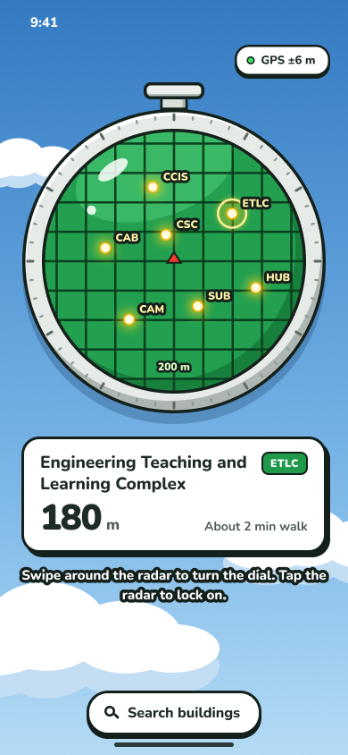
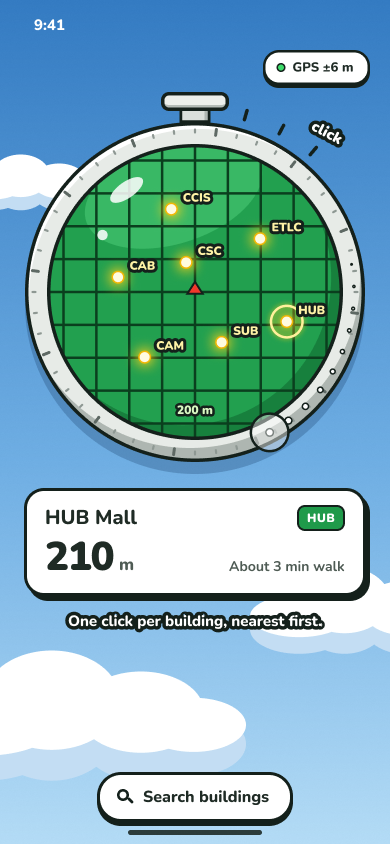
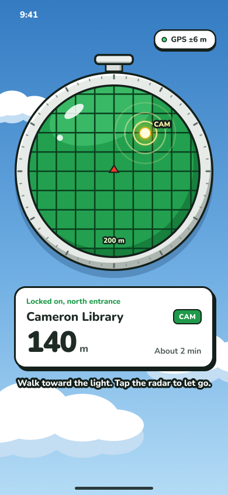
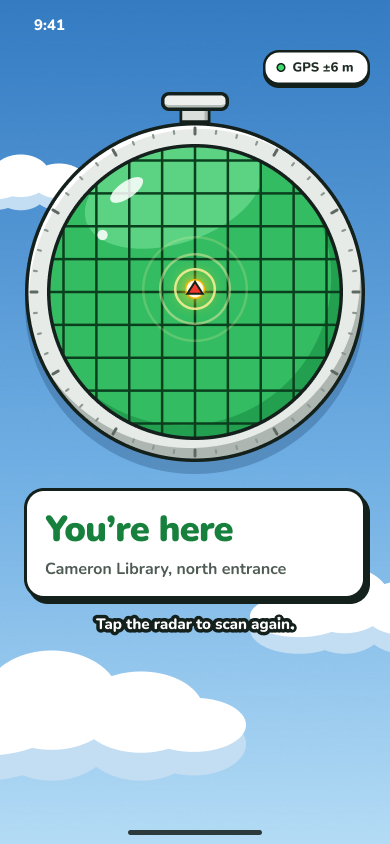
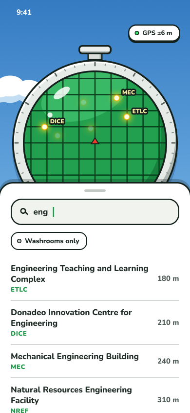
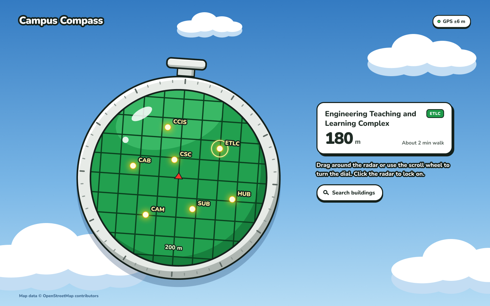
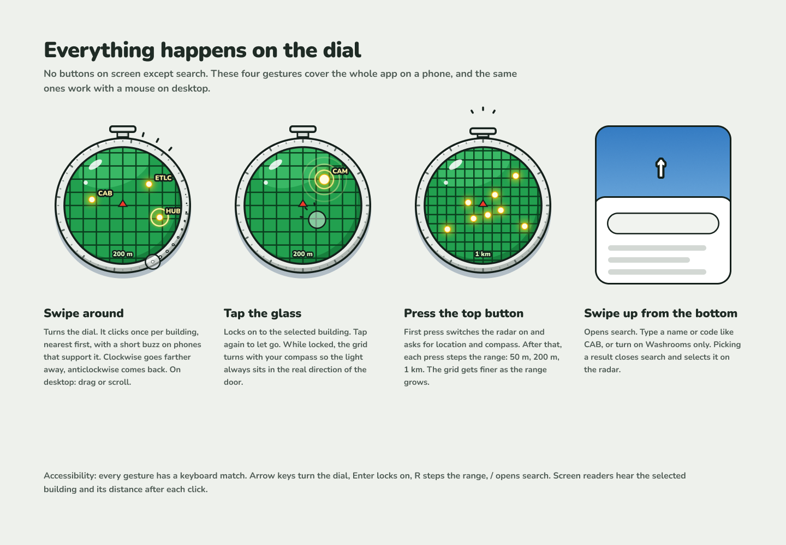

# Campus Compass (HackED Beta 2026)

A campus radar for the University of Alberta. Pick a building and the radar shows where
its closest entrance is. Walk until the light reaches the red marker in the middle.
Triple-tap the radar and it takes you to the nearest building with a public washroom.

Plain HTML, CSS and JavaScript. No backend, no build step, hosted on GitHub Pages.
Built for iPhone Safari, outdoors.

**Live:** https://choc-shake.github.io/hackedbeta-2026/
**Demo without a phone:** https://choc-shake.github.io/hackedbeta-2026/?demo

  
  
  
  

## Using it

The whole app is the radar. There is one button on screen, for search.

| Do this | What happens |
|---|---|
| Press the top button | First press switches the radar on and asks for location and compass. After that, each press changes the range: 50 m, 200 m, 500 m. |
| Swipe around the radar | Turns the dial. It clicks once per building, nearest first. Clockwise goes further away. |
| Tap the radar | Locks on to the selected building's closest door. Tap again to let go. |
| Triple-tap the radar | Locks on to the closest door of the nearest building with a public washroom. |
| Tap Search buildings, or swipe up from the bottom | Opens search. Type a name or a code like CAB, or turn on Washrooms only. |

While locked on, the grid turns with your compass, so the light always sits in the real
direction of the door. Within 10 m the light reaches the marker and the glass flashes.

On a laptop, drag around the radar or use the scroll wheel to turn the dial, and click to
lock on. Keyboard: arrow keys turn the dial, Enter locks on, W finds a washroom,
R changes the range and / opens search.

  
  

The design lives in Figma, in the file "Campus Compass — Radar redesign", page "v2 Dial only".

## How it works

All modules talk through one shared object, `state` (`js/state.js`):

| File | Role | Writes to `state` |
|---|---|---|
| `js/location.js` | Location: GPS position | `lat`, `lon`, `accuracy`, `locationError` |
| `js/sensors.js` | Sensors: compass heading, tilt, calibration | `heading`, `tilted`, `needsCalibration`, `sensorError` |
| `js/distance.js` | Distance: closest entrance, metres, arrival, nearest washroom | `destination`, `target`, `distance`, `arrived` |
| `js/angle.js` | Angle: bearing to the entrance, smoothed relative angle | `bearing`, `relAngle` |
| `js/search.js` | Search ranking | (nothing) |
| `js/app.js` | UI: the radar, dial gestures, card, search sheet, demo mode | (reads only) |
| `js/buildings.js` | Data: buildings, entrances, washroom flags | (data) |

Script load order is at the bottom of `index.html`: state, data, modules, then `app.js`.

The radar is one inline SVG drawn by `js/app.js`. Dots are placed by bearing and distance
to each building's closest door, relative to the way the phone faces. The triple-tap calls
`findNearestWashroom()` from `js/distance.js` and then `setDestination()`, the same path
as locking on by hand.

## Data

`js/buildings.js` is a one-time export from OpenStreetMap, made with
`tools/build_buildings.py` (the app never calls OpenStreetMap).

- 88 buildings, 315 entrances. Emergency exits and private doors are removed.
- 13 buildings have no doors mapped yet (Lister, Butterdome, PAW and others). For those the
  app guides to the nearest wall and says so. Add real doors to their `entrances` to fix.
- `washroom: true` is hand-picked. Please double-check it, since the triple-tap relies on it.
- Codes come from OpenStreetMap plus a few we added.

## Settings worth knowing

| Where | Setting | Meaning |
|---|---|---|
| `js/distance.js` | `ARRIVE_RADIUS_M = 10` | "You're here" distance. Raise it if GPS is too rough to trigger. |
| `js/distance.js` | `SWITCH_MARGIN_M = 6` | How much closer another door must be before we switch. |
| `js/sensors.js` | `MAGNETIC_DECLINATION = 0` | Set to 13 if the radar is consistently about 13° off (magnetic vs true north). |
| `js/app.js` | `RANGES = [50, 200, 500]` | Radar range steps for the top button, in metres. |
| `js/app.js` | `STEP_DEG = 22.5` | How far you turn the dial for one building. |
| `js/app.js` | `TAP_WINDOW_MS = 330` | Taps closer together than this count toward a triple-tap. |
| `js/location.js` | `FAKE_POSITION` | Fake GPS for desk testing. |
| `js/sensors.js` | `FAKE_HEADING` | Fake compass for desk testing. |

## History

We started as "Crap Map", a compass to the nearest washroom inside University Commons.
GPS doesn't work indoors and the building's steel bends the compass, so we moved outdoors.
The old pages are in `archive/commons/`. Module test pages: `Sensors/sensor-test.html`,
`Angle/test-angle.html`. The first arrow-based interface is in the git history before the
radar redesign.
